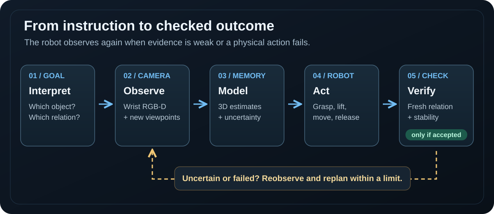
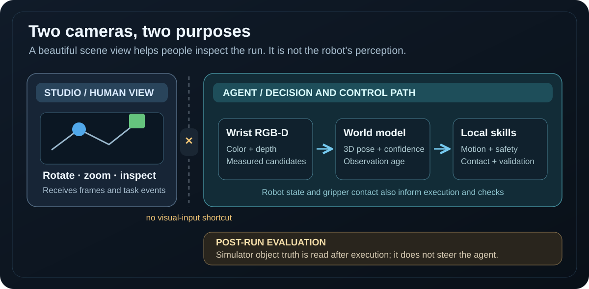
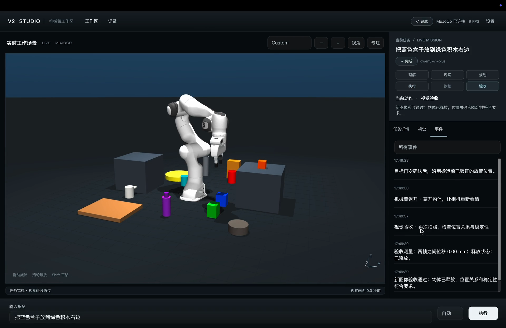

# V2 Studio · A robot that checks its own work

**A language-guided tabletop manipulation system in MuJoCo.** Give a simulated Franka Panda a task such as “place the blue box to the right of the green block.” V2 observes through an RGB-D camera, estimates where objects are, plans and executes a grasp, and takes a *new observation after release* before it reports success.

> **One-sentence demo:** `把蓝色盒子放到绿色积木右边` → find both objects → pick up the blue box → place it beside the green block → check that it is released, stable, and on the requested side.

## Watch a real V2 run

The following 30-second screen recording comes from V2 Studio running the actual agent and MuJoCo simulation. The right panel shows task stages and events while the arm manipulates the scene. GitHub plays the video directly below; a [downloadable MP4](evidence/v2-studio-blue-box-demo.mp4) is also kept in this repository.

https://github.com/user-attachments/assets/97993437-e0e0-47dd-9403-d650a6825dde

The ending is important: the arm has released the blue box, and Studio displays a successful **fresh visual validation**. This is one recorded task, not a measured success rate. [Recording details and other evidence](evidence/README.md).

## The idea in one picture



V2 is a **closed loop**. Each decision uses the most recent evidence available to that stage. A grasp is not considered successful just because the gripper closed, and a task is not considered complete just because the planned motion finished.

### 1. Turn the instruction into a checkable goal

For the demo, V2 separates the sentence into **object to move** (blue box), **reference object** (green block), and **desired relation** (to its right). The task interpreter can use a language model; a limited local rules mode is also available. The language model helps with meaning and a high-level plan, but the local robot code enforces the required manipulation sequence. It cannot skip grasp checks, final observation, or safety checks.

This distinction matters for flexible wording: the agent reasons about a requested object and relation rather than looking up a pre-registered scene coordinate. The current visual detector still has a limited vocabulary, so understanding the sentence does not guarantee that every real-world object can be recognized.

### 2. Observe the scene and measure candidate objects

The robot's simulated **wrist-mounted RGB-D camera** provides a color image, depth image, and camera calibration. The perception pipeline finds candidate image regions, uses valid depth to estimate their 3D positions and sizes, and records which observations support each estimate. Routine search uses **640 × 480**. When candidates look similar and visual review is available, V2 can capture **1280 × 960** detail images for semantic disambiguation; depth-based geometry still comes from the calibrated observation path. The arm can move to another viewpoint when a single view is insufficient.

Thus “find the blue box” is an evidence-building step: see pixels, associate them with depth, estimate a location, and decide whether the candidate is reliable enough to grasp. The system does **not** read object labels or positions from MuJoCo's scene registry while carrying out a task.

### 3. Keep a world model, then plan a feasible action

V2's world model tracks observed objects, estimated poses, confidence, and whether an observation has become stale. A task plan then uses local skills in a fixed, auditable order: observe → find → approach → grasp → **verify grasp** → lift → move → place → retreat → **verify task**. The planner can receive language-model suggestions, but it accepts a plan only when this required sequence remains intact.

For motion, V2 generates grasp and placement candidates from measured geometry. Inverse kinematics, workspace and collision checks, trajectory validation, and contact feedback determine whether a candidate can be executed. Motion is monitored in short segments. If the fingers close without a reliable hold, that is a failed grasp to diagnose, not proof that the object has been picked up.

### 4. Reobserve and validate the result

After placing and releasing the object, the arm retreats so the camera can see the result. V2 takes a fresh observation and checks the requested spatial relation together with release and stability. A task is marked **Complete** only when the final validator accepts that evidence. If a target is unclear, a grasp fails, or a path is blocked, recovery may reobserve or choose another feasible action within a bounded retry budget; persistent failure is reported rather than silently declared successful.

## What the video shows—and what the robot actually sees



The large 3D scene in Studio is a **human observer view**. You can rotate, zoom, and pan it to inspect a run. Its viewpoint and rendering quality do not determine what the agent knows. The agent acts from its own camera, estimated world model, robot state, and contact measurements. Studio receives the agent's events and images to explain the live task; it does not replace the agent's task logic or feed object registry coordinates into the robot.



In this frame, the right panel reports the final visual check. To understand *why* the task was accepted, follow the camera evidence and task events in Studio; the observer image alone is not the acceptance criterion.

## Run it locally

This repository includes the V2 source, tests, and a pinned Panda model submodule. The public setup below was tested with **Python 3.12** and **MuJoCo 3.14** on macOS.

```bash
git clone --recurse-submodules https://github.com/yejiasong1-ferrari/embodied-agent-v2.git
cd embodied-agent-v2
python3.12 -m venv .venv
.venv/bin/python -m pip install -r requirements-agent.txt
.venv/bin/python run_studio.py
```

In V2 Studio, enter `把蓝色盒子放到绿色积木右边` and run the task. Drag the 3D scene to rotate, scroll to zoom, and Shift-drag to pan. The inspector exposes the current action, visual evidence, recovery attempts, and final validation. For a terminal run with the limited local language rules, use:

```bash
.venv/bin/python run_agent.py '把蓝色盒子放到绿色积木右边' --offline
```

The [Studio guide](docs/v2-studio.md) explains controls and logs. For implementation details, start with the [agent state machine](src/agent/embodied_agent.py), [active perception](src/perception/active_perception.py), [world model](src/world/world_model.py), [task planner](src/agent/task_planner.py), and [final validator](src/validation/task_validator.py).

## Evidence, limits, and research direction

The [evidence folder](evidence/README.md) contains the demo recording and a few selected result files. Its online red-cup example, local Studio check, and three randomized offline trials are **separate runs**. They should not be combined into one trial or treated as an overall success-rate estimate. The public recording does not include its complete frame-by-frame robot log.

V2 is a **MuJoCo research prototype**, not a claim of general open-world recognition or performance on a physical arm. Default detection relies heavily on color and depth cues; an optional vision model can help resolve ambiguous candidates. Heavy occlusion, some container tasks, contact-rich grasp reliability, and transfer to real hardware remain open problems. Simulator ground truth is used only for evaluation after execution, never as the agent's shortcut to a solution.

The research question behind V2 is how to connect **language, active visual measurement, constrained manipulation, recovery, and post-action verification** in one inspectable loop. The next steps are stronger uncertainty-aware perception, more robust grasps, and validation on physical hardware. See the [architecture notes](docs/architecture-upgrade.md) for the broader design.
