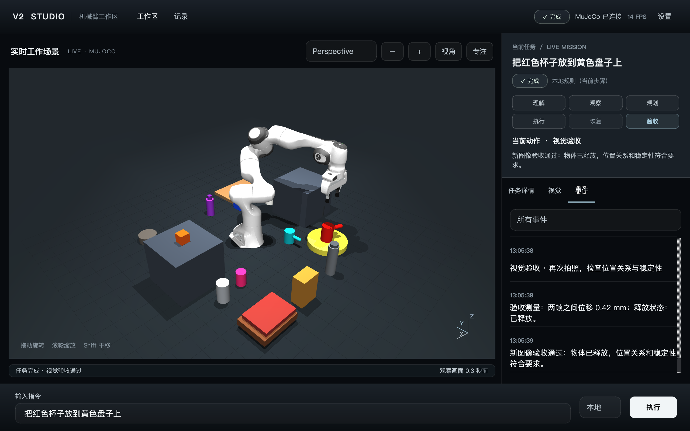

# 视觉驱动的 Embodied Agent 机械臂 · V2

**Vision-guided embodied manipulation in MuJoCo.** This project accepts a natural-language tabletop task, observes the scene through a simulated RGB-D camera, builds a measured world model, plans and executes bounded robot skills, and checks the outcome with fresh visual evidence. An LLM can interpret instructions and help distinguish visual candidates; local geometry, motion planning, contact monitoring, and validators control the robot. **The current implementation is a simulation research prototype, not a validated physical-robot deployment or an open-world object recognizer.**



上图来自一次**本地规则模式**的 Studio 完整任务；下方另列出的在线 LLM 结果来自**不同运行**，两者不能合并成一次实验。完整逐帧日志和 RGB-D 数据留在本机 `outputs/`，不包含在公开仓库中。

### 给研究者的快速说明

- **研究问题**：怎样把自然语言目标、来自相机的物体证据、三维操作规划与失败恢复连接成可验证的闭环。
- **当前实现**：MuJoCo 中的 Franka Panda，默认腕部 RGB-D 相机；常规观察 640×480，候选难辨且在线视觉模型可用时可拍 1280×960 细节图。
- **LLM 边界**：理解目标、按图像和候选辅助语义确认、建议高层策略；不能直接指定关节角、力或绕过本地安全与最终验收。
- **已知范围**：默认视觉主要基于有限词汇的颜色与深度几何；严重遮挡、开放类别和容器空腔操作尚未解决。项目尚未接入实体机器人。
- **可核查材料**：[精简演示证据](evidence/README.md)、[Studio 使用与数据边界](docs/v2-studio.md)、[能力与局限记录](docs/three-capabilities-worklog.md)。所列运行是选定案例及小规模回归，不代表总体成功率。

输入自然语言 → RGB-D 观察 → 世界模型 → 高层任务规划 → 本地技能/IK/运动规划 → 接触与视觉监控 → 重新观察验收。

新版默认入口已经改为真正的像素感知。**执行器不读取环境物体的 MuJoCo 名称、颜色、位置或类型登记库。** MuJoCo 只负责物理仿真、机器人本体状态和相机渲染；物体真值的读取被隔离到任务结束后的 `evaluation/`。

默认视觉是 HSV 分割、三维连通域与深度几何，属于有限词汇视觉。它不是“LLM 看一眼就控制电机”，也不等同于已经具备任意物体识别能力。LLM 理解任务、选择高层技能和提出恢复策略；低层运动由本地代码决定。

## 安装和环境

开发环境使用 Python 3.12.12、MuJoCo 3.14.0。依赖版本记录在 `requirements-agent.txt`；不同操作系统上的安装与图形渲染仍需自行验证。

```bash
# 新克隆时先取固定版本的 MuJoCo Menagerie 子模块
git clone --depth 1 --recurse-submodules --shallow-submodules https://github.com/yejiasong1-ferrari/embodied-agent-v2.git
cd embodied-agent-v2

# 全新克隆需要创建环境；已有可用 .venv 时跳过创建与安装
python3.12 -m venv .venv
.venv/bin/python -m pip install -r requirements-agent.txt
.venv/bin/python -m pip check

# 如果克隆时未使用 --recurse-submodules，再执行：
git submodule update --init --recursive --depth 1
```

`mujoco_menagerie/franka_emika_panda/` 提供 Panda 模型。`requirements-agent.txt` 记录本机验证过的版本。可选大模型不属于基本运行依赖。

## 运行

```bash
# 统一交互入口，中英文均可，输入 exit 退出
.venv/bin/python run_agent.py

# 本地可视化控制台：输入任务、实时全景、视觉证据、中文日志
.venv/bin/python run_studio.py
# macOS 也可双击「启动V2控制台.command」

# 明确不调用 LLM：本地有限语法解析 + 真正的 RGB-D 视觉
.venv/bin/python run_agent.py '把红色杯子放到黄色盘子上' --offline
.venv/bin/python run_agent.py 'Move the blue box to the right of the green block' --offline
.venv/bin/python run_agent.py '把挡住红色杯子的东西移开，然后把红色杯子拿出来' --offline --scenario blocked

# 必须使用在线 LLM，调用失败会明确报错
.venv/bin/python run_agent.py '把红色杯子放到黄色盘子上' --required-llm

# 原来的 V2 启动入口也已接到新 Agent
PYTHONPATH=src .venv/bin/python -m embodied_v2
PYTHONPATH=src .venv/bin/python -m embodied_v2.embodied_agent '把红色杯子放到黄色盘子上' --offline

# 只观察，不抓取
.venv/bin/python run_agent.py --perception-only --offline
```

新版 **V2 Studio** 是正式 PySide6 本地工作区：可自由旋转、缩放、平移的 3D 场景，任务/视觉/事件 Inspector、真实恢复与验收、专注模式、WorldModel 物体选择、带 REPLAY 标识的历史任务。GUI、Agent 执行和场景渲染分为三个线程；用户观察镜头与 Agent RGB-D 相机分离。R 复位视角，F 专注，Esc 退出；快捷键不会干扰指令输入。执行中保留 Stop，设置中区分 Reset View 与空闲时可用的 Reset Scene。

所有任务调用新的 `agent.EmbodiedAgent`，成功必须有真实 Validator 验收证据。运行方式、交互、数据来源、测试与限制见 [V2 Studio 文档](docs/v2-studio.md) 和 [UI 重构验收报告](docs/v2-studio-ui-acceptance.md)。原 V2 网页入口保留，其子进程已转向新 Agent。

## 配置

`config/agent.json` 是完整的默认配置。使用 `--config config/agent.json` 加载，未知字段会被拒绝。

包含 LLM、camera、robot、perception、planner、safety、recovery 七部分。工作空间、速度、力阈值、姿态限制、步长、抓取/恢复次数、总时长都有本地限制。数值控制参数不接受 LLM 输出。

当前 `config/agent.json` 和代码默认使用 **`camera.mode = "wrist"`**：机械臂腕部 RGB-D 相机按配置的扫描角度观察。也支持 `gantry` 模式的独立观察相机，但它不是当前默认值。腕部相机在操纵期间禁止自行移动机械臂去扫描；观测不足时停止，不能破坏正在执行的抓取。

## LLM 设置

沿用现有 `.env`（不会写入日志）：

```dotenv
DASHSCOPE_API_KEY=your_key
VLM_BASE_URL=https://dashscope.aliyuncs.com/compatible-mode/v1
VLM_MODEL=qwen3-vl-plus
```

也接受 `OPENAI_API_KEY` 和兼容的 Chat Completions 服务。默认 `auto`：有密钥则尝试在线；无密钥/可恢复调用错误时明确记录本地解析回退。`required` 禁止静默回退。任务理解、任务规划、恢复推理使用独立提示词和 Pydantic schema。额外关节字段、非法动作、漏掉验证的计划会被拒绝。

## 视觉与真值边界

1. 获取 RGB、米制 depth、K、光学坐标系到世界坐标系的变换、时间戳。
2. 用机器人自身的标定网格和关节位置去除自身像素。只使用机器人本体信息。
3. 颜色连通域或可替换 detector → mask → 有效深度。相同颜色在图片上连在一起时，再按三维连通域拆开。
4. `pixel_to_camera`、`camera_to_world`、`pixel_to_world` 投影出点云；估计表面、支撑高度、尺寸、中心和朝向。
5. 多视角融合、临时遮挡记忆；部分可见盘面用之前实际观察到的完整轮廓补全。不会从仿真查询缺失位置。
6. 碰撞模型由这些估计的物体包围盒建立。携带物体的位置假设来自抓取时的视觉相对位置和机器人自身运动，并不断用新点云及接触力验证。

可选模型：

- `perception.detector = "grounding_dino"`：真实 Hugging Face 推理 adapter，需要单独安装 `torch`、`transformers` 并下载 `dino_model` 权重。
- `perception.segmenter = "sam2"`：真实官方 SAM2 adapter，需要单独安装 SAM2、torch，并配置 checkpoint/config。
- `perception.detector = "vlm"`：低频图片语义识别，间隔帧由像素分割跟踪；同色多类别不会被强行映射成一种类别。

本次没有安装或声称验证 DINO/SAM2 的模型权重推理。默认 fallback 实际运行过。参考：[Grounding DINO 文档](https://huggingface.co/docs/transformers/model_doc/grounding-dino)、[官方 SAM2](https://github.com/facebookresearch/sam2)。

## 架构

- `agent/`：任务解释、符号计划、有限状态机、重规划。
- `perception/`：相机协议、检测/分割 adapter、深度投影、点云几何、主动观察、证据图。
- `world/`：对象身份、尺寸/位置/置信度、时效记忆、空间关系、实际看见的桌面覆盖。
- `skills/`：注册的观察/寻找/接近/抓取/验证/抬起/搬运/放置/退避技能。
- `manipulation/`：多个抓取候选、旧 IK 封装、OMPL RRT-Connect、插值/限速/轨迹验证。
- `validation/`：力、碰撞、范围、携带姿态、轨迹跟踪、附着和最终空间关系检查。
- `recovery/`：分类失败、不同候选、次数/时间限制、本地处理后再询问 LLM。
- `robot/`：`RobotInterface` 与 MuJoCo 控制实现；预留 `PolicyInterface`。
- `simulation/`：场景搭建、MuJoCo 相机、只有机器人和视觉障碍代理的碰撞模型、桌面入口。
- `studio/`：正式 PySide6 工作区、独立渲染线程、事件展示、用户相机和历史证据。
- `evaluation/`：任务结束后才能访问的真值评分接口。

任务/技能规划与数值运动规划分开。接近、抬起、搬运、下降采用不超过配置步长的短段运动，每段后重新拍照；每个物理步还有力和关节监控。所有实际发送的轨迹采样点先经过碰撞检查。

空间约定：米；世界 +z 向上，left/right 使用 -x/+x，front/behind 使用 -y/+y。`on` 需要水平重叠和支撑高度匹配。`inside` 提供几何关系判断；尚无可靠空腔重建时，放入任务会明确拒绝执行。

## Benchmark 与测试

```bash
.venv/bin/python scripts/benchmark_agent.py --trials 5 --seed 23 \
  --output outputs/agent_benchmark_acceptance.json
PYTHONPATH=src .venv/bin/python -m unittest discover -s tests -p 'test_agent_*.py'
PYTHONPATH=src .venv/bin/python -m unittest discover -s tests -p 'test_embodied_v2_*.py'
PYTHONPATH=src .venv/bin/python -m unittest src/test_embodied_agent.py
```

五类场景包括随机位置、蓝盒子到绿积木右边、附近障碍、目标初始在视野外、部分遮挡。顺序与随机种子可复现。场景构造和结束后的 evaluator 可以使用仿真对象名称；执行器只接收自然语言和 RGB-D 观测。报告同时保留 Agent 视觉成功与独立真值成功，不能只用其中一个算任务成功率。

公开仓库保留一份[升级后三项随机任务结果](evidence/offline-randomized-three-trials.json)：2/3 任务完成、3/3 抓取、2/3 放置、0 意外碰撞。第三项蓝盒在灰色障碍旁无安全低位路径，Agent 报告失败；该批使用离线语言解析，LLM 调用为 0。另有一次[在线 LLM 红杯放黄盘任务](evidence/online-red-cup-result.json)最终通过验收，其[任务与无密钥配置](evidence/online-red-cup-task.json)也一并提供。两类运行不是同一批实验，不能合成一个成功率。早期实现曾保存五项 5/5 的本地结果，但不能把它当作当前版本成功率。公开证据的来源和限制见 [evidence/README.md](evidence/README.md)。

新增测试检查投影、无效深度、记忆与空间关系、中文 schema、LLM 动作边界、三维拆分、可见空桌面、停止/力/姿态限制，以及运行层禁止读取仿真真值的静态边界。

## 日志与调试

每次任务写入 `outputs/agent/task_<UTC>_<id>/`：

- `task.json`：命令和不含密钥的配置。
- `events.jsonl`：解释、计划、观测、候选、轨迹、接触、失败、恢复、最终验收。
- `images/`：RGB、视觉覆盖图、depth/K/外参 NPZ。
- `world_states/`：每次观察后的估计世界模型。
- `result.json` 和 `debug.html`：结果、指标与可浏览的图像证据。

覆盖图显示框、mask、三维中心、目标、抓取点和当前规划路径。坐标/运动日志来自视觉和机器人本体，不是真值标注。大量 RGB-D 记录会占用磁盘空间。

## 扩展

**新 Skill**：继承 `Skill`，声明前提/成功/失败条件，实现 execute/monitor/validate，在 `SkillRegistry` 注册。若要让 LLM 选择它，还必须更新 `PlanStep` 白名单及本地顺序验证。

**新机器人**：实现 `RobotInterface`（含 FK/IK、观察障碍碰撞世界、受监控的轨迹执行），在启动层注入。上层 Agent 不导入 MuJoCo。

**新视觉模型**：实现 `ObjectDetector.detect(image, text_queries)` 或 `Segmenter.segment(image, boxes)`，输出真正的像素框/mask。深度和几何后处理继续复用。

**真实机械臂**：替换 `MuJoCoRobot`、`MujocoCamera` 和启动层；提供实际相机内参/手眼标定、时间同步、力传感与实体机器人急停/限速控制。仿真的泛化与安全性不能替代真机验证。VLA 将来可通过 `PolicyInterface` 提议技能动作，仍经过本地运动和安全检查。

详细审计、变更清单、验收结果和限制见 `docs/architecture-upgrade.md`。

## 公开范围与许可

本仓库包含完整的 V2 Python 源码、测试、启动脚本、配置示例和少量经审查的演示证据；本地 `.env`、虚拟环境和大量任务日志不公开。`mujoco_menagerie` 是指向上游固定提交的第三方子模块，使用时应遵守其自身许可证。

本项目目前**未添加仓库级许可证**。公开可读不等于授予复制、修改或再分发权利；后续如需开放使用，将单独确定许可证。
